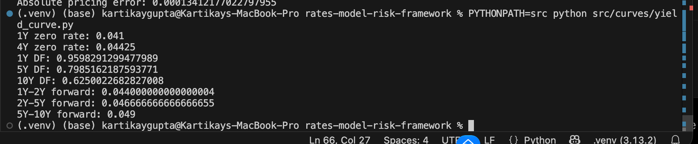
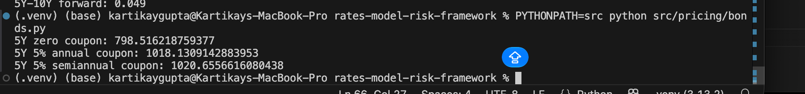
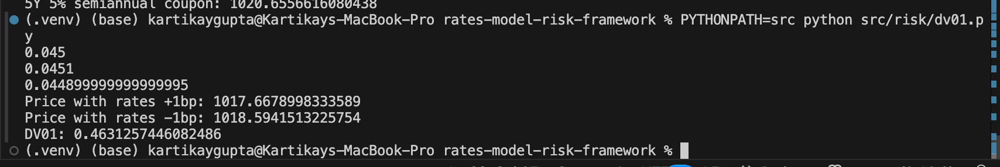
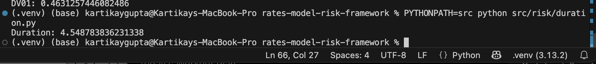
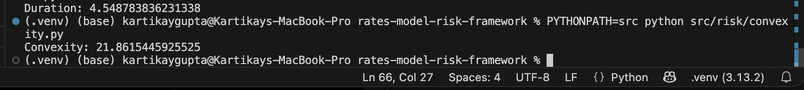
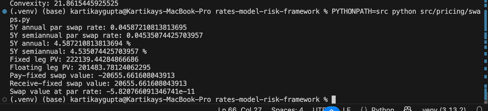
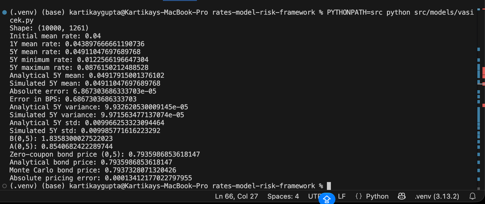

# Interest Rate Pricing & Model Risk Validation Framework

A Python-based quantitative finance framework for pricing and validating fixed-income and interest-rate models.

The project implements yield-curve analytics, bond and interest-rate swap pricing, interest-rate risk measures, and a Vasicek short-rate model. Numerical results are validated using analytical benchmarks and Monte Carlo simulation.

## Key Features

- Yield curve construction using zero rates
- Linear interpolation across maturities
- Discount-factor calculation
- Forward-rate calculation
- Zero-coupon and coupon bond pricing
- Interest-rate swap pricing
- Par swap-rate calculation
- DV01, modified duration, and convexity
- Parallel interest-rate shocks
- Vasicek short-rate model
- Euler-Maruyama Monte Carlo simulation
- Analytical Vasicek moments
- Analytical zero-coupon bond pricing
- Monte Carlo zero-coupon bond pricing
- Analytical vs. numerical model validation

---

## Project Structure

```text
rates-model-risk-framework/
│
├── src/
│   ├── curves/
│   │   └── yield_curve.py
│   │
│   ├── models/
│   │   └── vasicek.py
│   │
│   ├── pricing/
│   │   ├── bonds.py
│   │   └── swaps.py
│   │
│   ├── risk/
│   │   ├── dv01.py
│   │   ├── duration.py
│   │   └── convexity.py
│   │
│   └── validation/
│
├── results/
│   ├── yield_curve.png
│   ├── bond_pricing.png
│   ├── DV01.png
│   ├── modified_duration.png
│   ├── Convexity.png
│   ├── Swap_pricing.png
│   └── vasicek_full_validation.png
│
├── tests/
├── requirements.txt
└── README.md
```

---

# 1. Yield Curve Analytics

The framework represents a continuously compounded zero-rate curve and provides interpolation for maturities between observed curve points.

For maturity \(T\), the discount factor is

\[
P(0,T)=e^{-r(T)T}
\]

where \(r(T)\) is the continuously compounded zero rate.

Forward rates between maturities \(T_1\) and \(T_2\) are calculated as

\[
f(T_1,T_2)
=
\frac{r(T_2)T_2-r(T_1)T_1}{T_2-T_1}
\]

### Example Results

| Metric | Result |
|---|---:|
| 1Y Zero Rate | 4.10% |
| 4Y Zero Rate | 4.425% |
| 1Y Discount Factor | 0.959829 |
| 5Y Discount Factor | 0.798516 |
| 10Y Discount Factor | 0.625002 |
| 1Y-2Y Forward Rate | 4.40% |
| 2Y-5Y Forward Rate | 4.6667% |
| 5Y-10Y Forward Rate | 4.90% |



---

# 2. Fixed-Income Pricing

The framework prices both zero-coupon and coupon-bearing bonds using discount factors obtained from the zero-rate curve.

For a zero-coupon bond,

\[
P(0,T)=F \times DF(T)
\]

where \(F\) is the face value.

For a coupon bond, each coupon payment and the final principal payment are discounted separately using the corresponding maturity-specific discount factor.

### Example: $1,000 Face Value, 5-Year Maturity

| Instrument | Price |
|---|---:|
| 5Y Zero-Coupon Bond | $798.52 |
| 5Y 5% Annual Coupon Bond | $1,018.13 |
| 5Y 5% Semiannual Coupon Bond | $1,020.66 |



---

# 3. Interest-Rate Risk Analytics

The framework measures bond sensitivity to changes in the underlying zero-rate curve using central finite differences.

## DV01

DV01 estimates the dollar change in instrument value for a one-basis-point parallel change in interest rates.

A basis point is

\[
1\text{ bp}=0.0001
\]

The implementation uses parallel \(+1\) bp and \(-1\) bp shocks:

\[
DV01 \approx
\frac{P_{-1bp}-P_{+1bp}}{2}
\]

For the sample 5-year bond:

\[
DV01 = 0.46313
\]



## Modified Duration

Modified duration is estimated using

\[
D_{mod}
\approx
\frac{P_{-}-P_{+}}
{2P_0\Delta r}
\]

Result:

\[
D_{mod}=4.54878
\]



## Convexity

Convexity captures the second-order relationship between bond prices and interest rates.

\[
C
\approx
\frac{P_{-}+P_{+}-2P_0}
{P_0(\Delta r)^2}
\]

Result:

\[
C=21.86154
\]



---

# 4. Interest-Rate Swap Pricing

The project implements fixed-for-floating interest-rate swap valuation.

The fixed leg is calculated as

\[
PV_{fixed}
=
N K
\sum_{i=1}^{n}
\alpha_i DF(t_i)
\]

where

- \(N\) = notional
- \(K\) = fixed swap rate
- \(\alpha_i\) = accrual fraction
- \(DF(t_i)\) = discount factor

Under the simplified single-curve framework, the floating-leg present value is

\[
PV_{float}
=
N[1-DF(T)]
\]

The value of a pay-fixed swap is

\[
V_{swap}
=
PV_{float}-PV_{fixed}
\]

and the par swap rate is

\[
S=
\frac{1-DF(T)}
{\sum_i \alpha_i DF(t_i)}
\]

### 5-Year Swap Results

| Metric | Result |
|---|---:|
| Annual Par Swap Rate | 4.5872% |
| Semiannual Par Swap Rate | 4.5351% |
| Fixed Leg PV at 5% | $222,139.44 |
| Floating Leg PV | $201,483.78 |
| Pay-Fixed Swap Value | -$20,655.66 |
| Receive-Fixed Swap Value | $20,655.66 |
| Swap Value at Par | ≈ $0 |

The near-zero value at the calculated par rate provides a numerical consistency check for the swap-pricing implementation.



---

# 5. Vasicek Short-Rate Model

The framework implements the Vasicek mean-reverting stochastic short-rate model:

\[
dr_t
=
a(b-r_t)dt
+
\sigma dW_t
\]

where

- \(a\) = speed of mean reversion
- \(b\) = long-run mean rate
- \(\sigma\) = short-rate volatility
- \(W_t\) = Brownian motion

The simulated process uses Euler-Maruyama discretization:

\[
r_{t+\Delta t}
=
r_t
+
a(b-r_t)\Delta t
+
\sigma\sqrt{\Delta t}Z
\]

with

\[
Z\sim N(0,1)
\]

### Simulation Configuration

| Parameter | Value |
|---|---:|
| Initial Rate \(r_0\) | 4.00% |
| Mean-Reversion Speed \(a\) | 0.50 |
| Long-Run Mean \(b\) | 5.00% |
| Volatility \(\sigma\) | 1.00% |
| Horizon | 5 Years |
| Steps per Year | 252 |
| Monte Carlo Paths | 10,000 |

---

# 6. Statistical Model Validation

The analytical expected short rate under Vasicek is

\[
E[r_t]
=
b+(r_0-b)e^{-at}
\]

and the variance is

\[
Var(r_t)
=
\frac{\sigma^2}{2a}
(1-e^{-2at})
\]

The Monte Carlo simulation was benchmarked against these analytical quantities.

### 5-Year Validation Results

| Metric | Analytical | Monte Carlo |
|---|---:|---:|
| Mean Short Rate | 4.9179% | 4.9110% |
| Variance | 0.000099326 | 0.000099716 |
| Standard Deviation | 0.9966% | 0.9986% |

The difference between analytical and simulated 5-year mean rates was approximately

\[
\boxed{0.687\text{ bp}}
\]

This provides a numerical check that the discretized stochastic process reproduces the theoretical distribution with small simulation error.

---

# 7. Analytical vs. Monte Carlo Bond Pricing

Under Vasicek, a zero-coupon bond has the analytical form

\[
P(t,T)
=
A(t,T)e^{-B(t,T)r_t}
\]

with

\[
B(t,T)
=
\frac{1-e^{-a(T-t)}}{a}
\]

and

\[
A(t,T)
=
\exp
\left[
\left(
b-\frac{\sigma^2}{2a^2}
\right)
(B(t,T)-(T-t))
-
\frac{\sigma^2B(t,T)^2}{4a}
\right]
\]

Monte Carlo pricing instead discounts each simulated short-rate path:

\[
P(0,T)
=
E
\left[
e^{-\int_0^T r_tdt}
\right]
\]

The integral is numerically approximated along each simulated path.

### Pricing Validation

| Metric | Result |
|---|---:|
| Analytical 5Y ZCB Price | 0.7935987 |
| Monte Carlo 5Y ZCB Price | 0.7937328 |
| Absolute Pricing Error | 0.0001341 |
| Relative Pricing Error | ~0.017% |

For $1,000 face value, the analytical and Monte Carlo valuations differ by approximately **$0.13**.

This analytical-versus-independent-numerical comparison demonstrates the use of an alternative benchmark to assess pricing-model implementation and numerical behavior.



---

# Model Risk Considerations

The project is designed not only to generate valuations but also to examine model behavior and implementation risk.

### Vasicek Model Limitations

**Negative rates**

The Gaussian Vasicek process can generate negative short rates because the diffusion term has constant volatility and does not enforce a lower bound.

**Parameter sensitivity**

Pricing results depend on the selected mean-reversion speed, long-run mean, volatility, and initial short rate.

**Calibration**

The current Vasicek parameters are illustrative and are not calibrated to observed market instruments.

**Risk-neutral interpretation**

For the pricing experiments, the model parameters are treated as risk-neutral pricing parameters. The project does not separately estimate physical-measure dynamics or a market price of interest-rate risk.

**Discretization risk**

Monte Carlo paths are generated using Euler-Maruyama discretization. Numerical results can therefore depend on the selected time-step size.

**Monte Carlo sampling error**

Numerical valuations are estimates based on a finite number of simulated paths and therefore contain sampling error.

**Curve framework**

Swap pricing uses a simplified single-curve framework. Modern collateralized derivatives markets generally distinguish discounting and forwarding curves.

These limitations are important when assessing whether a model is suitable for a particular valuation or risk-management application.

---

# Validation Philosophy

The project applies several forms of quantitative validation:

1. **Internal consistency checks** — for example, confirming that a swap valued at its calculated par rate has approximately zero initial value.
2. **Analytical benchmarking** — comparing simulated Vasicek moments with theoretical expectations.
3. **Independent numerical benchmarking** — comparing analytical Vasicek bond prices with Monte Carlo estimates.
4. **Sensitivity analysis** — measuring bond-price responses to parallel interest-rate shocks using DV01, duration, and convexity.
5. **Model limitation assessment** — documenting assumptions and situations in which the implemented models may be inappropriate.

---

# Technologies

- Python
- NumPy
- SciPy
- pandas
- Matplotlib
- pytest

---

# Running the Project

Create and activate a virtual environment:

```bash
python3 -m venv .venv
source .venv/bin/activate
```

Install dependencies:

```bash
pip install -r requirements.txt
```

Run individual components from the project root:

```bash
PYTHONPATH=src python src/curves/yield_curve.py
PYTHONPATH=src python src/pricing/bonds.py
PYTHONPATH=src python src/risk/dv01.py
PYTHONPATH=src python src/risk/duration.py
PYTHONPATH=src python src/risk/convexity.py
PYTHONPATH=src python src/pricing/swaps.py
PYTHONPATH=src python src/models/vasicek.py
```

---

# Summary

This project implements an end-to-end introductory interest-rate pricing and model-validation workflow covering:

**Yield Curve → Fixed-Income Pricing → Interest-Rate Risk → Swap Pricing → Stochastic Short-Rate Modeling → Monte Carlo Pricing → Analytical Benchmarking → Model Risk Assessment**

The strongest validation result is the comparison between closed-form and Monte Carlo Vasicek zero-coupon bond pricing, where 10,000 simulated paths produced approximately **0.017% relative pricing error** against the analytical benchmark.

The framework is intended as an educational quantitative-finance and model-risk implementation rather than a production trading or valuation system.